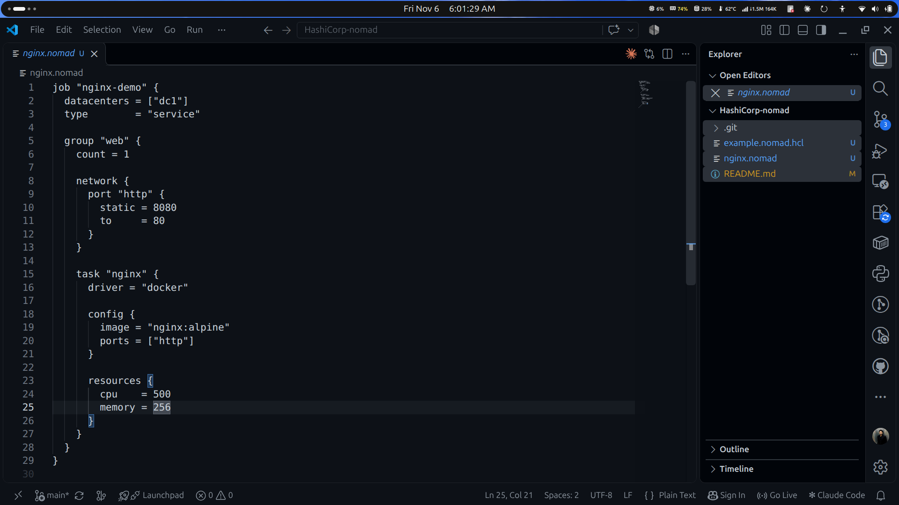
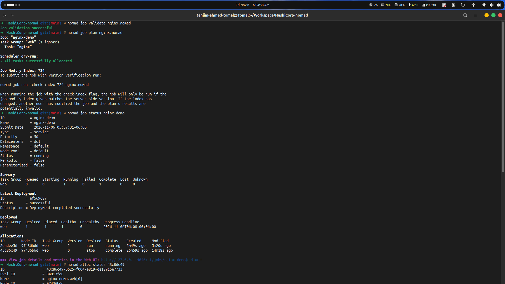
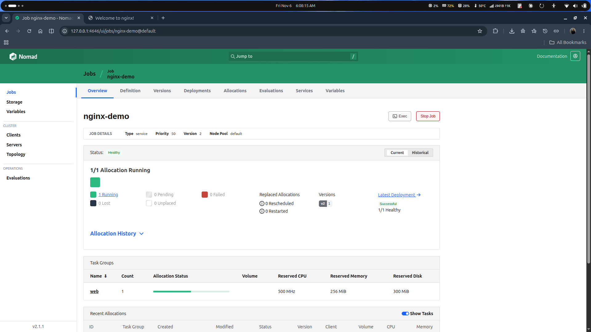

 <p align="center">
  
</p>

<h1 align="center">HashiCorp Nomad</h1>

<p align="center">
  Hands-on Learning: Job Specifications with HCL
</p>

<p align="center">
  
  
  
</p>

## Overview

A beginner-level DevOps project focused on understanding HashiCorp Nomad and creating, validating, and deploying a Docker-based job specification using HCL.

The project uses Nginx to explore Nomad's job lifecycle, task groups, allocations, and workload monitoring.

## Tech Stack

- HashiCorp Nomad
- HCL
- Docker
- Nginx Alpine
- Ubuntu Linux

## Architecture

```text
       HCL Job Specification
                |
                v
         Nomad Scheduler
                |
                v
            Allocation
                |
                v
           Docker Driver
                |
                v
          Nginx Container
                |
                v
       localhost:8080 -> :80
```

## Project Structure

```text
HashiCorp-nomad/
├── screenshots/
│   ├── 01-nomad-job-specification.png
│   ├── 02-nomad-validation.png
│   └── 03-nomad-dashboard.png
├── example.nomad.hcl
├── nginx.nomad
└── README.md
```

## Job Configuration

The `nginx.nomad` file defines:

- Job: `nginx-demo`
- Task Group: `web`
- Instances: `1`
- Driver: `docker`
- Image: `nginx:alpine`
- Port Mapping: `8080:80`
- CPU: `500 MHz`
- Memory: `256 MiB`

## Validation and Deployment

Validated the job specification:

```bash
nomad job validate nginx.nomad
```

**Result:** `Job validation successful`

Planned and deployed the job:

```bash
nomad job plan nginx.nomad
nomad job run nginx.nomad
```

Verified the Nginx welcome page at `http://localhost:8080`.

## Screenshots & Evidence

### 01. Nomad Job Specification



### 02. Job Validation and Status



### 03. Nomad Dashboard



## Problems & Solutions

| Challenge | Solution |
|---|---|
| Dashboard initially showed no jobs | Created and submitted an HCL job specification |
| Validation did not start the workload | Used `nomad job plan` and `nomad job run` |
| Job stopped after testing | Redeployed the job to verify its healthy status |

## Key Learnings

- Understanding Nomad architecture and job specifications.
- Working with HCL configuration files.
- Managing jobs, task groups, and allocations.
- Running Docker workloads through Nomad.
- Validating, deploying, monitoring, and stopping jobs.
- Inspecting allocation details and application logs.

---

<p align="center">
  <b>Project Status: Completed</b>
</p>
